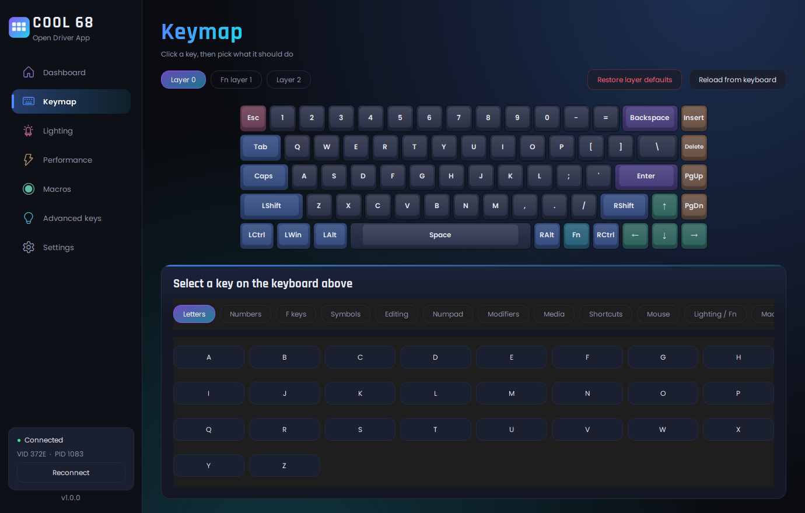
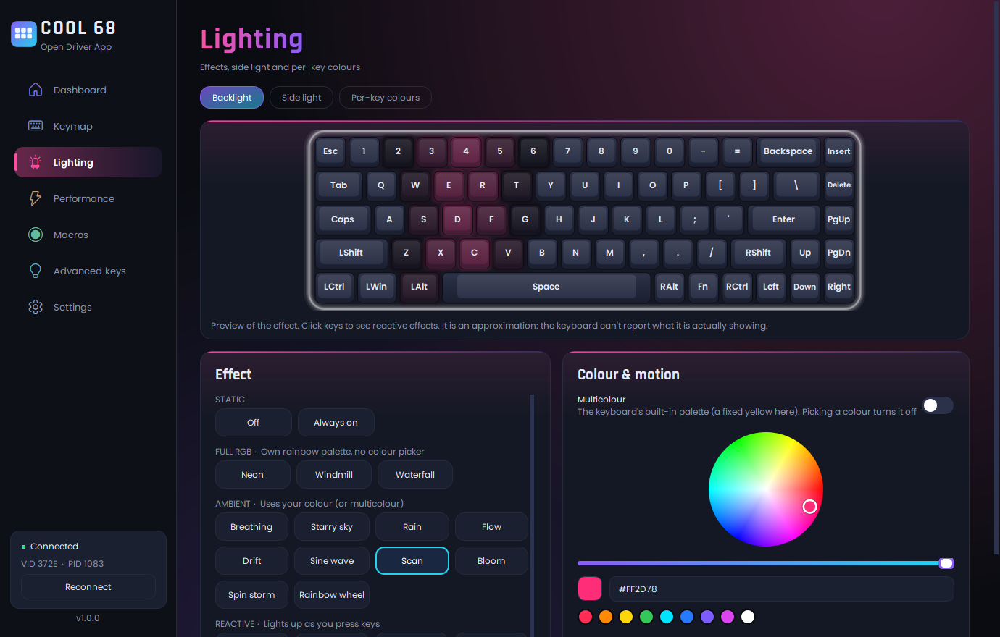
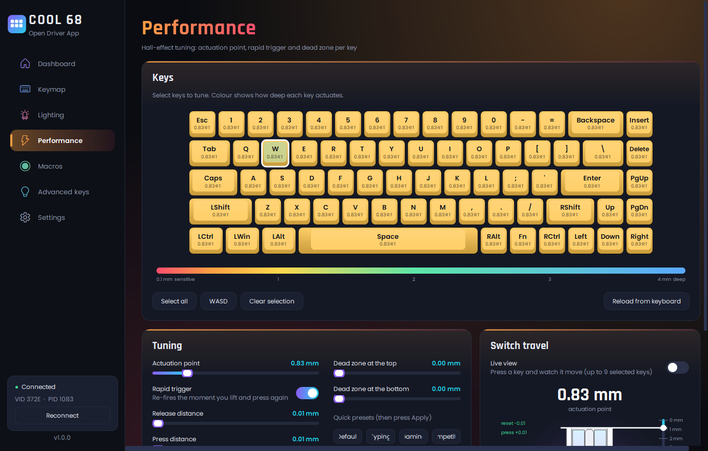

# COOL 68 Open Driver App

An open-source desktop app for the **Dareu COOL 68** hall-effect keyboard. It replaces the vendor's configuration
software: lighting and per-key RGB, key remapping, macros, hall-effect tuning (actuation point, rapid trigger, dead zones),
advanced keys, profiles, polling rate, and a live view of how far each key is pressed.

It talks to the keyboard directly over USB (HID), so there is **no driver to install and no vendor software needed**.



| Lighting | Performance |
|---|---|
|  |  |

## Download

Get the latest build from the **[Releases](../../releases)** page:

* **`COOL68-Open-Driver-Setup-x.y.z.exe`**: the installer (per-user, no admin rights needed, adds a Start menu entry and an uninstaller).
* **`COOL68-Open-Driver-x.y.z-portable.exe`**: a single file, nothing to install.

Windows 10/11, 64-bit, keyboard connected with the USB cable.

> **Windows SmartScreen may warn on first launch** ("Windows protected your PC"). The builds are signed with a
> self-signed certificate, which Windows does not trust by default, so the publisher shows as unknown. Click
> **More info → Run anyway**. You can check the file against `SHA256SUMS.txt` on the release page, and the source is all
> here. See [docs/SIGNING.md](docs/SIGNING.md).

## What it does

| Page | |
|---|---|
| **Dashboard** | Firmware, profile switcher, polling rate (1000 / 2000 / 4000 / 8000 Hz), Win-lock, animated lighting preview |
| **Keymap** | Click a key, pick what it does. Three layers (layer 0, Fn layer, layer 2): keys, modifiers, media, shortcuts, mouse buttons, your macros, raw values. **Restore layer defaults** undoes any mistake |
| **Lighting** | All 20 effects grouped by what they support, colour wheel, brightness/speed, multicolour, side light, and a per-key colour painter. The preview animates each effect |
| **Performance** | Per-key **actuation point (0.1–4.0 mm)**, **rapid trigger**, **dead zones**, presets, a heat map, and the **live view**: press a key and watch the switch drawing move |
| **Macros** | Record or type key sequences, upload them to the keyboard, assign them to keys |
| **Advanced keys** | Toggle, tap/hold, SOCD (last input / priority / neutral) and multi-point keys |
| **Settings** | Sleep timeout, key-combo mode, auto-calibration, overdrive, profile names |

## Is it safe?

* It only sends **configuration commands**. It never flashes firmware, so it cannot brick the keyboard.
* It only opens a device with USB ID `372E:1083`. It will not touch any other device.
* Every setting can be changed back from the app. If a remap goes wrong, **Keymap → Restore layer defaults**.
* It is **unofficial** and not affiliated with Dareu. Use it at your own risk (see the [license](LICENSE)).

## Good to know

* Only one program can talk to the keyboard's configuration interface at a time, so **close the vendor app** if you
  have it installed. This app doesn't need it.
* Changing the polling rate makes the keyboard re-appear on USB for a moment. The app reconnects by itself, and also
  reconnects when you unplug and replug the cable.
* The **effect previews are simulations**. The keyboard runs the effects itself and cannot report what its LEDs are
  doing, so they are matched to how the effects look on the real keyboard.
* **Multicolour** is on/off only on this keyboard (a fixed yellow palette). The firmware has no selectable palette.
* The side light's effects are numbered, not named; try them and see.
* `Fn+Tab` and `Fn+\` are defined in the firmware but do nothing; the app labels them *No function*.
* Not supported: the dynamic-keystroke and "end" advanced-key types, and re-calibrating the switches.

## Tested with

COOL 68, firmware `0x0124`, USB `372E:1083`, wired. Other Dareu boards that share this protocol might partly work, but
they are untested and the app only opens the COOL 68's USB ID.

## Build from source

```powershell
git clone https://github.com/fernandoorteganu-glitch/Cool-68---open-driver---EN
cd Cool-68---open-driver---EN
python -m pip install -r requirements-dev.txt
python gui.py                 # run the app
python -m pytest              # unit tests (no keyboard needed)
python tools/hardware_selftest.py --yes     # optional: test against a real keyboard, restores everything
powershell -ExecutionPolicy Bypass -File scriptsuild.ps1     # portable exe + installer in release/ (needs Inno Setup)
```

More in [docs/BUILDING.md](docs/BUILDING.md). The USB protocol, reverse-engineered from the keyboard's own traffic, is
documented in [docs/PROTOCOL.md](docs/PROTOCOL.md). `cool68.py` is a standalone Python driver you can use in your
own scripts:

```python
from cool68 import Cool68
kb = Cool68()
print(kb.get_light())                       # {'mode': 16, 'brightness': 20, ...}
kb.set_key(0, 98, 0x68)                     # layer 0: Insert -> F13
kb.close()
```

## Contributing

Issues and pull requests are welcome, especially: other keyboards/firmware versions, the effects' exact looks, and
anything in *Good to know* that you can improve. Please run `python -m pytest` before sending a change.

## License

[MIT](LICENSE). Bundled fonts (Poppins, Rajdhani) are under the SIL Open Font License; see
[THIRD_PARTY_NOTICES.md](THIRD_PARTY_NOTICES.md).
